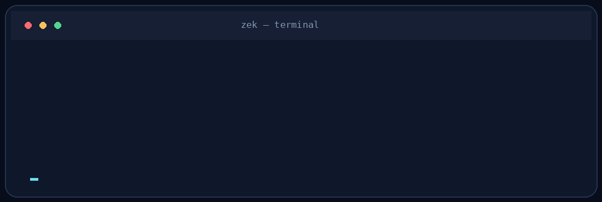
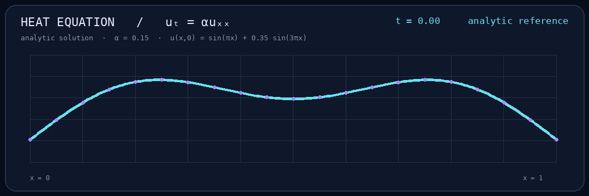
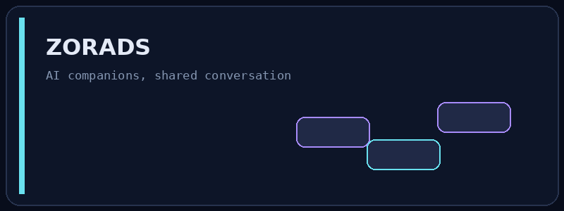
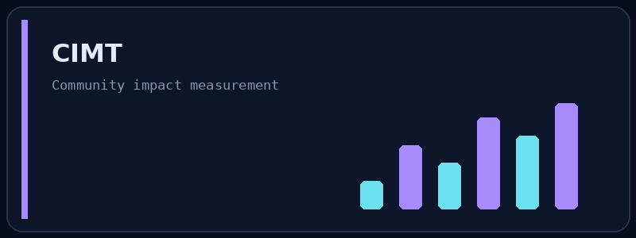
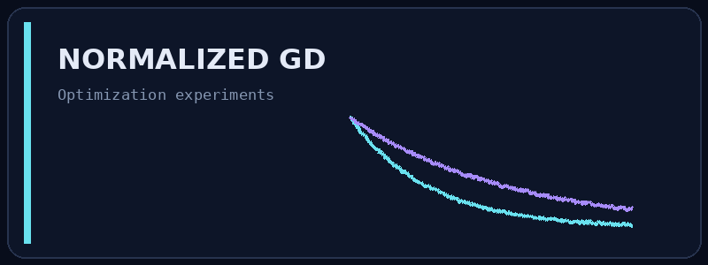
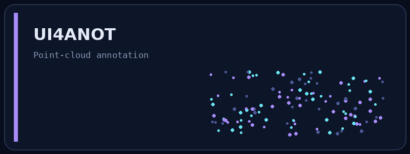
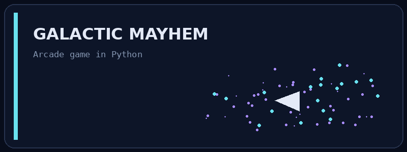
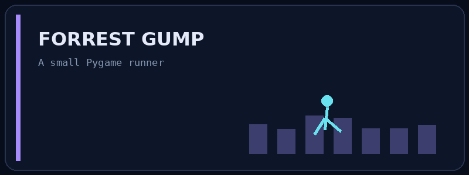
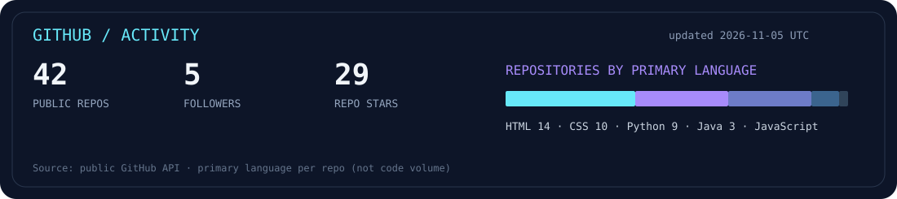

**I build things to understand how they work.**

[Projects](#selected-work) · [Research](#research-in-motion) · [Activity](#github-in-motion) · [LinkedIn](https://www.linkedin.com/in/prashant-subedi/) · [Portfolio](https://nikolas-ai.github.io/Portfolio/)

### a little about me

CS student at **Texas State University**. I like machine learning, math, software that solves actual problems, and the occasional game project.

These days I'm studying **how physics-informed neural networks generalize** across PDE parameters. When I'm not doing that, I'm usually building or fixing something.

### research in motion

A little visual from what I'm studying: a one-dimensional heat-equation solution gradually smooths out. This is an **analytical reference**, not a trained PINN prediction. The interesting research question is whether a PINN can match reference solutions for parameters it never saw during training.

### selected work

<table>
<tr>
<td width="50%"> <b><a href="https://github.com/nikolas-AI/Zorads-HckTx">Zorads / AImigos</a></b> Real friends and AI companions in one group chat.</td>
<td width="50%"> <b><a href="https://github.com/nikolas-AI/CIMT">CIMT</a></b> Measuring the community impact of clinic services and volunteer work.</td>
</tr><tr>
<td> <b><a href="https://github.com/nikolas-AI/Normalized-GD">Normalized Gradient Descent</a></b> Experiments with neural-network optimization.</td>
<td> <b><a href="https://github.com/nikolas-AI/UI4ANOT">UI4ANOT</a></b> Desktop annotation tool for 3D point-cloud quality assessment.</td>
</tr><tr>
<td> <b><a href="https://github.com/nikolas-AI/Galactic_Mayhem">Galactic Mayhem</a></b> A Python arcade game.</td>
<td> <b><a href="https://github.com/nikolas-AI/Forrest_Gump">Forrest Gump</a></b> A Pygame runner.</td>
</tr>
</table>

### tools I reach for

`Python` · `C / C++` · `JavaScript` · `React` · `Git` · `Linux` · `Figma`

### github in motion

More activity

---

Built with curiosity, Python, and a few too many revisions. · <a href="https://github.com/nikolas-AI">@nikolas-AI</a>

